<picture>
  <source media="(prefers-color-scheme: dark)" srcset="assets/hero-dark.svg">
  <source media="(prefers-color-scheme: light)" srcset="assets/hero-light.svg">
  
</picture>

  <a href="#featured-projects"><b>Projects</b></a> ·
  <a href="#tech-stack"><b>Stack</b></a> ·
  <a href="#github-activity"><b>Activity</b></a> ·
  <a href="#lets-work-together"><b>Contact</b></a>

## About me

I'm a full-stack engineer from the Philippines who likes building things people actually use, from a marketplace with mobile apps to a sign-language learning system. I work mostly in **TypeScript, React and Next.js** with **Supabase/PostgreSQL**, and I'm growing into **AI engineering**: local models, retrieval and agents that stay private by design.

- 🔭 **Building now:** [Kamayo](#featured-projects), an interactive Filipino Sign Language learning system
- 🤖 **Exploring:** local LLMs with Ollama, retrieval (RAG), and AI features that respect user data
- 🛡️ **I care about:** security by default (row-level security, server-side checks), accessibility and tests
- 🤝 **Open to:** collaborations and full-stack or AI engineering roles

## Tech stack

  <b>Frontend</b> 
  <picture>
    <source media="(prefers-color-scheme: light)" srcset="https://skillicons.dev/icons?i=ts,js,react,nextjs,vite,tailwind,threejs,html,css&theme=light">
    
  </picture>

  <b>Backend, data &amp; mobile</b> 
  <picture>
    <source media="(prefers-color-scheme: light)" srcset="https://skillicons.dev/icons?i=nodejs,supabase,postgres&theme=light">
    
  </picture> 
  

  <b>Tools &amp; deployment</b> 
  <picture>
    <source media="(prefers-color-scheme: light)" srcset="https://skillicons.dev/icons?i=git,github,vercel,netlify,figma,vscode&theme=light">
    
  </picture> 
  

  <b>AI</b> 
  
  
  

## Featured projects

<picture>
  <source media="(prefers-color-scheme: dark)" srcset="assets/projects-dark.svg">
  <source media="(prefers-color-scheme: light)" srcset="assets/projects-light.svg">
  
</picture>

<table>
  <tr>
    <td width="50%" valign="top">
      <h3>🛍️ Tindero</h3>
      
Pre-loved and community marketplace for the Philippines. Role-based access, passkey (WebAuthn) sign-in, ID scanning with OCR, and Android/iOS apps built from the same codebase with Capacitor.

      
<code>TypeScript</code> <code>React</code> <code>Supabase</code> <code>Capacitor</code> <code>WebAuthn</code>

      
    </td>
    <td width="50%" valign="top">
      <h3>🤟 Kamayo</h3>
      
Interactive Filipino Sign Language learning system with a 100-level path. Progress and rewards are checked on the server, every private record is protected by row-level security, and database rules are covered by tests.

      
<code>React 19</code> <code>TypeScript</code> <code>Vite</code> <code>Supabase</code> <code>Vitest</code>

      
    </td>
  </tr>
  <tr>
    <td width="50%" valign="top">
      <h3>🥐 PandeLoot</h3>
      
A daily “loot drop” storefront for Filipino bakery treats, with Gemini-powered features, Google sign-in and live drops. Deployed on Vercel.

      
<code>Next.js</code> <code>TypeScript</code> <code>Supabase</code> <code>Gemini API</code> <code>Framer Motion</code>

      
    </td>
    <td width="50%" valign="top">
      <h3>🧠 Anna</h3>
      
A private AI companion that runs entirely on your own PC through Ollama. She indexes only the folders you allow, remembers only what you approve, and drafts suggestions instead of editing files. Reachable from a phone over a private Tailscale network.

      
<code>Node.js</code> <code>Ollama</code> <code>Embeddings / RAG</code> <code>Tailscale</code>

      
    </td>
  </tr>
  <tr>
    <td width="50%" valign="top">
      <h3>🔍 GitHub Profile Viewer</h3>
      
Search any GitHub username for live stats, a contribution heatmap with snake animation, top repositories and a language breakdown.

      
<code>React</code> <code>Vite</code> <code>Tailwind CSS</code> <code>GitHub API</code>

      
    </td>
    <td width="50%" valign="top">
      <h3>🪐 SCHNEIZEL.DEV</h3>
      
My portfolio as a 3D solar system: each project is a planet you can fly to, built with React Three Fiber.

      
<code>Next.js</code> <code>React Three Fiber</code> <code>Three.js</code> <code>Zustand</code>

      
    </td>
  </tr>
</table>

## GitHub activity

  <picture>
    <source media="(prefers-color-scheme: light)" srcset="https://streak-stats.demolab.com/?user=SchneizelCodes&hide_border=true&background=ffffff&stroke=d0d7de&ring=0f766e&fire=0f766e&currStreakNum=1f2328&sideNums=1f2328&currStreakLabel=0f766e&sideLabels=59636e&dates=59636e">
    
  </picture>

<picture>
  <source media="(prefers-color-scheme: dark)" srcset="https://raw.githubusercontent.com/SchneizelCodes/SchneizelCodes/output/snake-dark.svg">
  <source media="(prefers-color-scheme: light)" srcset="https://raw.githubusercontent.com/SchneizelCodes/SchneizelCodes/output/snake.svg">
  
</picture>

## Let's work together

I'm open to collaborations and full-stack or AI engineering roles. The quickest way to reach me is a direct message.

  
  <!-- Add yours, then remove the arrows around each line to show it:
  
  
  
  -->

The animated header and project reel are hand-written SVG, generated by <code>scripts/build-svgs.mjs</code>. They pause automatically for visitors who prefer reduced motion.
