<picture><source media="(max-width: 768px) and (prefers-color-scheme: dark)" srcset="assets/hero-m-dark.svg"><source media="(max-width: 768px) and (prefers-color-scheme: light)" srcset="assets/hero-m-light.svg"><source media="(prefers-color-scheme: dark)" srcset="assets/hero-dark.svg"><source media="(prefers-color-scheme: light)" srcset="assets/hero-light.svg"></picture>

  <a href="https://github.com/SchneizelCodes"><picture><source media="(max-width: 768px) and (prefers-color-scheme: dark)" srcset="assets/sw-auto-on-m-dark.svg"><source media="(max-width: 768px) and (prefers-color-scheme: light)" srcset="assets/sw-auto-on-m-light.svg"><source media="(prefers-color-scheme: dark)" srcset="assets/sw-auto-on-dark.svg"><source media="(prefers-color-scheme: light)" srcset="assets/sw-auto-on-light.svg"></picture></a>
  <a href="https://github.com/SchneizelCodes/SchneizelCodes/blob/main/themes/dark.md"><picture><source media="(max-width: 768px) and (prefers-color-scheme: dark)" srcset="assets/sw-dark-off-m-dark.svg"><source media="(max-width: 768px) and (prefers-color-scheme: light)" srcset="assets/sw-dark-off-m-light.svg"><source media="(prefers-color-scheme: dark)" srcset="assets/sw-dark-off-dark.svg"><source media="(prefers-color-scheme: light)" srcset="assets/sw-dark-off-light.svg"></picture></a>
  <a href="https://github.com/SchneizelCodes/SchneizelCodes/blob/main/themes/split.md"><picture><source media="(max-width: 768px) and (prefers-color-scheme: dark)" srcset="assets/sw-split-off-m-dark.svg"><source media="(max-width: 768px) and (prefers-color-scheme: light)" srcset="assets/sw-split-off-m-light.svg"><source media="(prefers-color-scheme: dark)" srcset="assets/sw-split-off-dark.svg"><source media="(prefers-color-scheme: light)" srcset="assets/sw-split-off-light.svg"></picture></a>
  <a href="https://github.com/SchneizelCodes/SchneizelCodes/blob/main/themes/light.md"><picture><source media="(max-width: 768px) and (prefers-color-scheme: dark)" srcset="assets/sw-light-off-m-dark.svg"><source media="(max-width: 768px) and (prefers-color-scheme: light)" srcset="assets/sw-light-off-m-light.svg"><source media="(prefers-color-scheme: dark)" srcset="assets/sw-light-off-dark.svg"><source media="(prefers-color-scheme: light)" srcset="assets/sw-light-off-light.svg">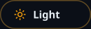</picture></a>

  <a href="#about"><picture><source media="(max-width: 768px) and (prefers-color-scheme: dark)" srcset="assets/nav-about-m-dark.svg"><source media="(max-width: 768px) and (prefers-color-scheme: light)" srcset="assets/nav-about-m-light.svg"><source media="(prefers-color-scheme: dark)" srcset="assets/nav-about-dark.svg"><source media="(prefers-color-scheme: light)" srcset="assets/nav-about-light.svg"></picture></a>
  <a href="#stack"><picture><source media="(max-width: 768px) and (prefers-color-scheme: dark)" srcset="assets/nav-stack-m-dark.svg"><source media="(max-width: 768px) and (prefers-color-scheme: light)" srcset="assets/nav-stack-m-light.svg"><source media="(prefers-color-scheme: dark)" srcset="assets/nav-stack-dark.svg"><source media="(prefers-color-scheme: light)" srcset="assets/nav-stack-light.svg"></picture></a>
  <a href="#projects"><picture><source media="(max-width: 768px) and (prefers-color-scheme: dark)" srcset="assets/nav-projects-m-dark.svg"><source media="(max-width: 768px) and (prefers-color-scheme: light)" srcset="assets/nav-projects-m-light.svg"><source media="(prefers-color-scheme: dark)" srcset="assets/nav-projects-dark.svg"><source media="(prefers-color-scheme: light)" srcset="assets/nav-projects-light.svg">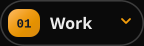</picture></a>
  <a href="#activity"><picture><source media="(max-width: 768px) and (prefers-color-scheme: dark)" srcset="assets/nav-activity-m-dark.svg"><source media="(max-width: 768px) and (prefers-color-scheme: light)" srcset="assets/nav-activity-m-light.svg"><source media="(prefers-color-scheme: dark)" srcset="assets/nav-activity-dark.svg"><source media="(prefers-color-scheme: light)" srcset="assets/nav-activity-light.svg">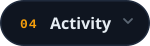</picture></a>
  <a href="#certificates"><picture><source media="(max-width: 768px) and (prefers-color-scheme: dark)" srcset="assets/nav-certificates-m-dark.svg"><source media="(max-width: 768px) and (prefers-color-scheme: light)" srcset="assets/nav-certificates-m-light.svg"><source media="(prefers-color-scheme: dark)" srcset="assets/nav-certificates-dark.svg"><source media="(prefers-color-scheme: light)" srcset="assets/nav-certificates-light.svg">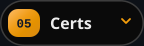</picture></a>
  <a href="#contact"><picture><source media="(max-width: 768px) and (prefers-color-scheme: dark)" srcset="assets/nav-contact-m-dark.svg"><source media="(max-width: 768px) and (prefers-color-scheme: light)" srcset="assets/nav-contact-m-light.svg"><source media="(prefers-color-scheme: dark)" srcset="assets/nav-contact-dark.svg"><source media="(prefers-color-scheme: light)" srcset="assets/nav-contact-light.svg"></picture></a>

<a href="https://joshua-camachodev.vercel.app"><picture><source media="(max-width: 768px) and (prefers-color-scheme: dark)" srcset="assets/portfolio-m-dark.svg"><source media="(max-width: 768px) and (prefers-color-scheme: light)" srcset="assets/portfolio-m-light.svg"><source media="(prefers-color-scheme: dark)" srcset="assets/portfolio-dark.svg"><source media="(prefers-color-scheme: light)" srcset="assets/portfolio-light.svg"></picture></a>

<picture><source media="(max-width: 768px) and (prefers-color-scheme: dark)" srcset="assets/h-about-m-dark.svg"><source media="(max-width: 768px) and (prefers-color-scheme: light)" srcset="assets/h-about-m-light.svg"><source media="(prefers-color-scheme: dark)" srcset="assets/h-about-dark.svg"><source media="(prefers-color-scheme: light)" srcset="assets/h-about-light.svg"></picture>

I'm a full-stack engineer from the Philippines who likes building things people actually use, from a marketplace with mobile apps to a sign-language learning system. I work mostly in **TypeScript, React and Next.js** with **Supabase/PostgreSQL**, and I'm growing into **AI engineering**: local models, retrieval and agents that stay private by design.

<picture><source media="(max-width: 768px) and (prefers-color-scheme: dark)" srcset="assets/about-m-dark.svg"><source media="(max-width: 768px) and (prefers-color-scheme: light)" srcset="assets/about-m-light.svg"><source media="(prefers-color-scheme: dark)" srcset="assets/about-dark.svg"><source media="(prefers-color-scheme: light)" srcset="assets/about-light.svg"></picture>

<picture><source media="(max-width: 768px) and (prefers-color-scheme: dark)" srcset="assets/h-stack-m-dark.svg"><source media="(max-width: 768px) and (prefers-color-scheme: light)" srcset="assets/h-stack-m-light.svg"><source media="(prefers-color-scheme: dark)" srcset="assets/h-stack-dark.svg"><source media="(prefers-color-scheme: light)" srcset="assets/h-stack-light.svg"></picture>

<picture><source media="(max-width: 768px) and (prefers-color-scheme: dark)" srcset="assets/stack-m-dark.svg"><source media="(max-width: 768px) and (prefers-color-scheme: light)" srcset="assets/stack-m-light.svg"><source media="(prefers-color-scheme: dark)" srcset="assets/stack-dark.svg"><source media="(prefers-color-scheme: light)" srcset="assets/stack-light.svg">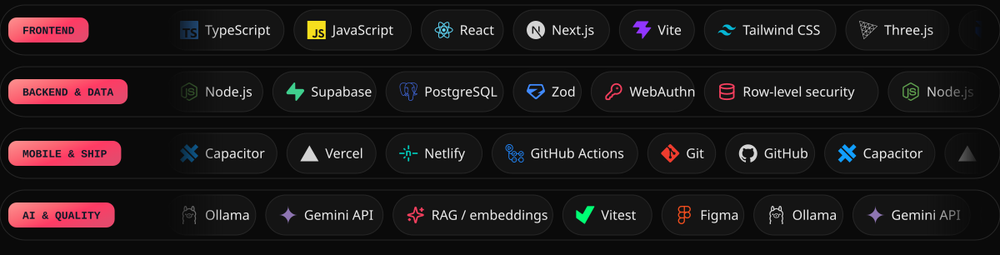</picture>

<picture><source media="(max-width: 768px) and (prefers-color-scheme: dark)" srcset="assets/h-projects-m-dark.svg"><source media="(max-width: 768px) and (prefers-color-scheme: light)" srcset="assets/h-projects-m-light.svg"><source media="(prefers-color-scheme: dark)" srcset="assets/h-projects-dark.svg"><source media="(prefers-color-scheme: light)" srcset="assets/h-projects-light.svg"></picture>

<a href="https://tinderoph.vercel.app"><picture><source media="(max-width: 768px) and (prefers-color-scheme: dark)" srcset="assets/feature-tindero-m-dark.svg"><source media="(max-width: 768px) and (prefers-color-scheme: light)" srcset="assets/feature-tindero-m-light.svg"><source media="(prefers-color-scheme: dark)" srcset="assets/feature-tindero-dark.svg"><source media="(prefers-color-scheme: light)" srcset="assets/feature-tindero-light.svg"></picture></a> <a href="https://tinderoph.vercel.app"><picture><source media="(max-width: 768px) and (prefers-color-scheme: dark)" srcset="assets/link-tindero-site-m-dark.svg"><source media="(max-width: 768px) and (prefers-color-scheme: light)" srcset="assets/link-tindero-site-m-light.svg"><source media="(prefers-color-scheme: dark)" srcset="assets/link-tindero-site-dark.svg"><source media="(prefers-color-scheme: light)" srcset="assets/link-tindero-site-light.svg"></picture></a><a href="https://www.facebook.com/share/1A3EnLVQAT/?mibextid=wwXIfr"><picture><source media="(max-width: 768px) and (prefers-color-scheme: dark)" srcset="assets/link-tindero-fb-m-dark.svg"><source media="(max-width: 768px) and (prefers-color-scheme: light)" srcset="assets/link-tindero-fb-m-light.svg"><source media="(prefers-color-scheme: dark)" srcset="assets/link-tindero-fb-dark.svg"><source media="(prefers-color-scheme: light)" srcset="assets/link-tindero-fb-light.svg">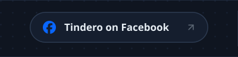</picture></a><a href="https://github.com/SchneizelCodes/Tindero"><picture><source media="(max-width: 768px) and (prefers-color-scheme: dark)" srcset="assets/link-tindero-repo-m-dark.svg"><source media="(max-width: 768px) and (prefers-color-scheme: light)" srcset="assets/link-tindero-repo-m-light.svg"><source media="(prefers-color-scheme: dark)" srcset="assets/link-tindero-repo-dark.svg"><source media="(prefers-color-scheme: light)" srcset="assets/link-tindero-repo-light.svg">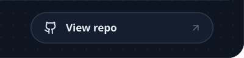</picture></a>

  <a href="https://kamayo-lyart.vercel.app"><picture><source media="(max-width: 768px) and (prefers-color-scheme: dark)" srcset="assets/card-kamayo-m-dark.svg"><source media="(max-width: 768px) and (prefers-color-scheme: light)" srcset="assets/card-kamayo-m-light.svg"><source media="(prefers-color-scheme: dark)" srcset="assets/card-kamayo-dark.svg"><source media="(prefers-color-scheme: light)" srcset="assets/card-kamayo-light.svg"></picture></a>

  <a href="https://pande-loot.vercel.app"><picture><source media="(max-width: 768px) and (prefers-color-scheme: dark)" srcset="assets/card-pandeloot-m-dark.svg"><source media="(max-width: 768px) and (prefers-color-scheme: light)" srcset="assets/card-pandeloot-m-light.svg"><source media="(prefers-color-scheme: dark)" srcset="assets/card-pandeloot-dark.svg"><source media="(prefers-color-scheme: light)" srcset="assets/card-pandeloot-light.svg"></picture></a>

  <picture><source media="(max-width: 768px) and (prefers-color-scheme: dark)" srcset="assets/card-anna-m-dark.svg"><source media="(max-width: 768px) and (prefers-color-scheme: light)" srcset="assets/card-anna-m-light.svg"><source media="(prefers-color-scheme: dark)" srcset="assets/card-anna-dark.svg"><source media="(prefers-color-scheme: light)" srcset="assets/card-anna-light.svg"></picture>

  <a href="https://playful-pudding-f9a7df.netlify.app"><picture><source media="(max-width: 768px) and (prefers-color-scheme: dark)" srcset="assets/card-viewer-m-dark.svg"><source media="(max-width: 768px) and (prefers-color-scheme: light)" srcset="assets/card-viewer-m-light.svg"><source media="(prefers-color-scheme: dark)" srcset="assets/card-viewer-dark.svg"><source media="(prefers-color-scheme: light)" srcset="assets/card-viewer-light.svg"></picture></a>

  <a href="https://schneizeldev.vercel.app"><picture><source media="(max-width: 768px) and (prefers-color-scheme: dark)" srcset="assets/card-portfolio-m-dark.svg"><source media="(max-width: 768px) and (prefers-color-scheme: light)" srcset="assets/card-portfolio-m-light.svg"><source media="(prefers-color-scheme: dark)" srcset="assets/card-portfolio-dark.svg"><source media="(prefers-color-scheme: light)" srcset="assets/card-portfolio-light.svg"></picture></a>

<picture><source media="(max-width: 768px) and (prefers-color-scheme: dark)" srcset="assets/h-activity-m-dark.svg"><source media="(max-width: 768px) and (prefers-color-scheme: light)" srcset="assets/h-activity-m-light.svg"><source media="(prefers-color-scheme: dark)" srcset="assets/h-activity-dark.svg"><source media="(prefers-color-scheme: light)" srcset="assets/h-activity-light.svg"></picture>

  <picture><source media="(max-width: 768px) and (prefers-color-scheme: dark)" srcset="https://raw.githubusercontent.com/SchneizelCodes/SchneizelCodes/output/activity-m-dark.svg"><source media="(max-width: 768px) and (prefers-color-scheme: light)" srcset="https://raw.githubusercontent.com/SchneizelCodes/SchneizelCodes/output/activity-m-light.svg"><source media="(prefers-color-scheme: dark)" srcset="https://raw.githubusercontent.com/SchneizelCodes/SchneizelCodes/output/activity-dark.svg"><source media="(prefers-color-scheme: light)" srcset="https://raw.githubusercontent.com/SchneizelCodes/SchneizelCodes/output/activity-light.svg"></picture>

  <picture><source media="(max-width: 768px) and (prefers-color-scheme: dark)" srcset="https://raw.githubusercontent.com/SchneizelCodes/SchneizelCodes/output/snake-card-m-dark.svg"><source media="(max-width: 768px) and (prefers-color-scheme: light)" srcset="https://raw.githubusercontent.com/SchneizelCodes/SchneizelCodes/output/snake-card-m-light.svg"><source media="(prefers-color-scheme: dark)" srcset="https://raw.githubusercontent.com/SchneizelCodes/SchneizelCodes/output/snake-card-dark.svg"><source media="(prefers-color-scheme: light)" srcset="https://raw.githubusercontent.com/SchneizelCodes/SchneizelCodes/output/snake-card-light.svg"></picture>

<picture><source media="(max-width: 768px) and (prefers-color-scheme: dark)" srcset="assets/h-certificates-m-dark.svg"><source media="(max-width: 768px) and (prefers-color-scheme: light)" srcset="assets/h-certificates-m-light.svg"><source media="(prefers-color-scheme: dark)" srcset="assets/h-certificates-dark.svg"><source media="(prefers-color-scheme: light)" srcset="assets/h-certificates-light.svg"></picture>

<picture><source media="(max-width: 768px) and (prefers-color-scheme: dark)" srcset="assets/certificates-m-dark.svg"><source media="(max-width: 768px) and (prefers-color-scheme: light)" srcset="assets/certificates-m-light.svg"><source media="(prefers-color-scheme: dark)" srcset="assets/certificates-dark.svg"><source media="(prefers-color-scheme: light)" srcset="assets/certificates-light.svg"></picture> <a href="https://ude.my/UC-5e30f6f3-65f8-4eec-91c1-bb84714b4e80"><picture><source media="(max-width: 768px) and (prefers-color-scheme: dark)" srcset="assets/link-cert-udemy-m-dark.svg"><source media="(max-width: 768px) and (prefers-color-scheme: light)" srcset="assets/link-cert-udemy-m-light.svg"><source media="(prefers-color-scheme: dark)" srcset="assets/link-cert-udemy-dark.svg"><source media="(prefers-color-scheme: light)" srcset="assets/link-cert-udemy-light.svg">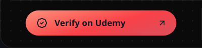</picture></a><a href="https://github.com/SchneizelCodes/SchneizelCodes/blob/main/certificates/cisco-intro-modern-ai.pdf"><picture><source media="(max-width: 768px) and (prefers-color-scheme: dark)" srcset="assets/link-cert-cisco-m-dark.svg"><source media="(max-width: 768px) and (prefers-color-scheme: light)" srcset="assets/link-cert-cisco-m-light.svg"><source media="(prefers-color-scheme: dark)" srcset="assets/link-cert-cisco-dark.svg"><source media="(prefers-color-scheme: light)" srcset="assets/link-cert-cisco-light.svg">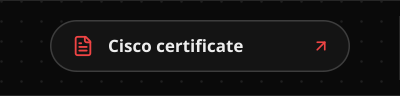</picture></a><a href="https://github.com/SchneizelCodes/SchneizelCodes/blob/main/certificates/global-ai-manila-agentcamp-badge.png"><picture><source media="(max-width: 768px) and (prefers-color-scheme: dark)" srcset="assets/link-cert-badge-m-dark.svg"><source media="(max-width: 768px) and (prefers-color-scheme: light)" srcset="assets/link-cert-badge-m-light.svg"><source media="(prefers-color-scheme: dark)" srcset="assets/link-cert-badge-dark.svg"><source media="(prefers-color-scheme: light)" srcset="assets/link-cert-badge-light.svg">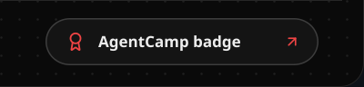</picture></a>

<picture><source media="(max-width: 768px) and (prefers-color-scheme: dark)" srcset="assets/h-contact-m-dark.svg"><source media="(max-width: 768px) and (prefers-color-scheme: light)" srcset="assets/h-contact-m-light.svg"><source media="(prefers-color-scheme: dark)" srcset="assets/h-contact-dark.svg"><source media="(prefers-color-scheme: light)" srcset="assets/h-contact-light.svg"></picture>

<a href="https://www.linkedin.com/in/joshua-manuel-camacho-b392963b0/"><picture><source media="(max-width: 768px) and (prefers-color-scheme: dark)" srcset="assets/cta-m-dark.svg"><source media="(max-width: 768px) and (prefers-color-scheme: light)" srcset="assets/cta-m-light.svg"><source media="(prefers-color-scheme: dark)" srcset="assets/cta-dark.svg"><source media="(prefers-color-scheme: light)" srcset="assets/cta-light.svg"></picture></a> <a href="https://www.linkedin.com/in/joshua-manuel-camacho-b392963b0/"><picture><source media="(max-width: 768px) and (prefers-color-scheme: dark)" srcset="assets/social-linkedin-m-dark.svg"><source media="(max-width: 768px) and (prefers-color-scheme: light)" srcset="assets/social-linkedin-m-light.svg"><source media="(prefers-color-scheme: dark)" srcset="assets/social-linkedin-dark.svg"><source media="(prefers-color-scheme: light)" srcset="assets/social-linkedin-light.svg"></picture></a><a href="https://www.instagram.com/schneizel_jmnl/"><picture><source media="(max-width: 768px) and (prefers-color-scheme: dark)" srcset="assets/social-instagram-m-dark.svg"><source media="(max-width: 768px) and (prefers-color-scheme: light)" srcset="assets/social-instagram-m-light.svg"><source media="(prefers-color-scheme: dark)" srcset="assets/social-instagram-dark.svg"><source media="(prefers-color-scheme: light)" srcset="assets/social-instagram-light.svg"></picture></a><a href="https://www.tiktok.com/@jmnl_inc"><picture><source media="(max-width: 768px) and (prefers-color-scheme: dark)" srcset="assets/social-tiktok-m-dark.svg"><source media="(max-width: 768px) and (prefers-color-scheme: light)" srcset="assets/social-tiktok-m-light.svg"><source media="(prefers-color-scheme: dark)" srcset="assets/social-tiktok-dark.svg"><source media="(prefers-color-scheme: light)" srcset="assets/social-tiktok-light.svg">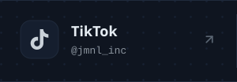</picture></a><a href="https://www.facebook.com/joshuamanuel.camacho"><picture><source media="(max-width: 768px) and (prefers-color-scheme: dark)" srcset="assets/social-facebook-m-dark.svg"><source media="(max-width: 768px) and (prefers-color-scheme: light)" srcset="assets/social-facebook-m-light.svg"><source media="(prefers-color-scheme: dark)" srcset="assets/social-facebook-dark.svg"><source media="(prefers-color-scheme: light)" srcset="assets/social-facebook-light.svg">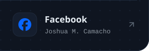</picture></a>

