<picture><source media="(max-width: 768px)" srcset="../assets/hero-m-split.svg"></picture>

  <a href="https://github.com/SchneizelCodes"><picture><source media="(max-width: 768px)" srcset="../assets/sw-auto-off-m-dark.svg">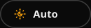</picture></a>
  <a href="dark.md"><picture><source media="(max-width: 768px)" srcset="../assets/sw-dark-off-m-dark.svg"></picture></a>
  <a href="split.md"><picture><source media="(max-width: 768px)" srcset="../assets/sw-split-on-m-light.svg"></picture></a>
  <a href="light.md"><picture><source media="(max-width: 768px)" srcset="../assets/sw-light-off-m-light.svg"></picture></a>

  <a href="#about"><picture><source media="(max-width: 768px)" srcset="../assets/nav-about-m-dark.svg">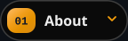</picture></a>
  <a href="#stack"><picture><source media="(max-width: 768px)" srcset="../assets/nav-stack-m-dark.svg"></picture></a>
  <a href="#projects"><picture><source media="(max-width: 768px)" srcset="../assets/nav-projects-m-split.svg"></picture></a>
  <a href="#activity"><picture><source media="(max-width: 768px)" srcset="../assets/nav-activity-m-light.svg"></picture></a>
  <a href="#contact"><picture><source media="(max-width: 768px)" srcset="../assets/nav-contact-m-light.svg"></picture></a>

<picture><source media="(max-width: 768px)" srcset="../assets/h-about-m-split.svg"></picture>

I'm a full-stack engineer from the Philippines who likes building things people actually use, from a marketplace with mobile apps to a sign-language learning system. I work mostly in **TypeScript, React and Next.js** with **Supabase/PostgreSQL**, and I'm growing into **AI engineering**: local models, retrieval and agents that stay private by design.

<picture><source media="(max-width: 768px)" srcset="../assets/about-m-split.svg"></picture>

<picture><source media="(max-width: 768px)" srcset="../assets/h-stack-m-split.svg"></picture>

<picture><source media="(max-width: 768px)" srcset="../assets/stack-m-split.svg"></picture>

<picture><source media="(max-width: 768px)" srcset="../assets/h-projects-m-split.svg"></picture>

<a href="https://tinderoph.vercel.app"><picture><source media="(max-width: 768px)" srcset="../assets/feature-tindero-m-split.svg"></picture></a> <a href="https://tinderoph.vercel.app"><picture><source media="(max-width: 768px)" srcset="../assets/link-tindero-site-m-dark.svg">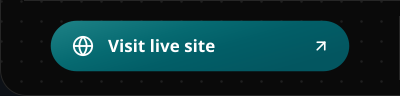</picture></a><a href="https://www.facebook.com/share/1A3EnLVQAT/?mibextid=wwXIfr"><picture><source media="(max-width: 768px)" srcset="../assets/link-tindero-fb-m-split.svg">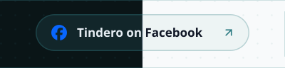</picture></a><a href="https://github.com/SchneizelCodes/Tindero"><picture><source media="(max-width: 768px)" srcset="../assets/link-tindero-repo-m-light.svg">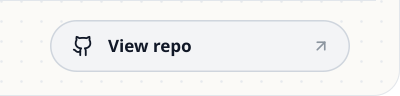</picture></a>

  <picture><source media="(max-width: 768px)" srcset="../assets/card-kamayo-m-split.svg"></picture>

  <a href="https://github.com/SchneizelCodes/PandeLoot"><picture><source media="(max-width: 768px)" srcset="../assets/card-pandeloot-m-split.svg"></picture></a>

  <picture><source media="(max-width: 768px)" srcset="../assets/card-anna-m-split.svg"></picture>

  <a href="https://playful-pudding-f9a7df.netlify.app"><picture><source media="(max-width: 768px)" srcset="../assets/card-viewer-m-split.svg"></picture></a>

  <a href="https://github.com/SchneizelCodes/SCHNEIZEL.DEV"><picture><source media="(max-width: 768px)" srcset="../assets/card-portfolio-m-split.svg"></picture></a>

<picture><source media="(max-width: 768px)" srcset="../assets/h-activity-m-split.svg"></picture>

  <picture><source media="(max-width: 768px)" srcset="https://raw.githubusercontent.com/SchneizelCodes/SchneizelCodes/output/activity-m-split.svg"></picture>

  <picture><source media="(max-width: 768px)" srcset="https://raw.githubusercontent.com/SchneizelCodes/SchneizelCodes/output/snake-card-m-split.svg"></picture>

<picture><source media="(max-width: 768px)" srcset="../assets/h-contact-m-split.svg"></picture>

<a href="https://www.linkedin.com/in/joshua-manuel-camacho-b392963b0/"><picture><source media="(max-width: 768px)" srcset="../assets/cta-m-split.svg"></picture></a> <a href="https://www.linkedin.com/in/joshua-manuel-camacho-b392963b0/"><picture><source media="(max-width: 768px)" srcset="../assets/social-linkedin-m-dark.svg">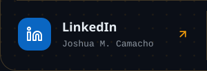</picture></a><a href="https://www.instagram.com/schneizel_jmnl/"><picture><source media="(max-width: 768px)" srcset="../assets/social-instagram-m-dark.svg">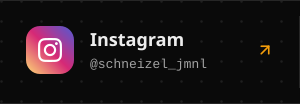</picture></a><a href="https://www.tiktok.com/@jmnl_inc"><picture><source media="(max-width: 768px)" srcset="../assets/social-tiktok-m-light.svg">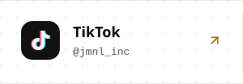</picture></a><a href="https://www.facebook.com/joshuamanuel.camacho"><picture><source media="(max-width: 768px)" srcset="../assets/social-facebook-m-light.svg">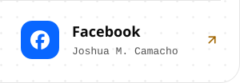</picture></a>

Viewing the <b>split</b> theme. GitHub can’t switch themes in place, so each option is its own page. <a href="https://github.com/SchneizelCodes">Back to my profile</a>

